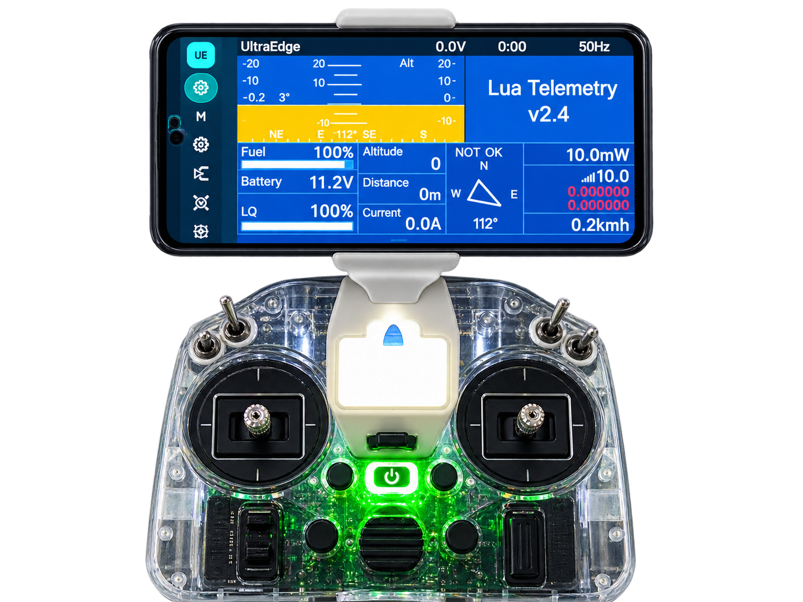

# edgetx-ue — EdgeTX with the UltraEdge companion overlay

 

This is [EdgeTX](https://github.com/EdgeTX/edgetx) plus the UltraEdge companion overlay. It lets the **UltraEdge**
Android app, connected over USB, edit supported model and radio settings, show telemetry and run Lua tools. The radio
runs the control loop and validates every setting it saves. Unplug the phone and the radio keeps flying exactly as
EdgeTX does. With the overlay compiled out, the build is byte-for-byte identical to upstream EdgeTX.

<table>
  <tr>
    <td width="50%"> Home dashboard: RSSI, battery, timer, model.</td>
    <td width="50%"> Your radio's telemetry screens on the phone.</td>
  </tr>
</table>

## Download
Get the `.bin` for your radio from **[Releases](../../releases)** and follow `FLASHING.md` in that release.

| Release | Radios | Build | For |
|---|---|---|---|
| **v1.1.2.3** (Latest, production) | RadioMaster Pocket, Zorro, TX16S; FrSky QX7 / QX7S (**not** the QX7 ACCESS) | Full build (all EdgeTX menus plus UltraEdge) | App 1.3.2 or newer (Google Play) |
| **1.1.22** (pre-release, beta) | 56 EdgeTX radios, listed with their status in `SUPPORTED-RADIOS.md` on the release | Companion build on black-and-white radios, full build on colour radios | App 1.4.3 or newer (Play open testing) |

A radio is marked **Verified** only after the checklist in `SUPPORTED-RADIOS.md` has passed on real hardware. Every
other build is compiled and identity-checked, but not yet flown. If you fly one, please report how it went.

## Get the app
- **UltraEdge for EdgeTX RC Radios** (Google Play): https://play.google.com/store/apps/details?id=com.ultraedge.companion
- Manual, downloads (sound packs, Lua scripts) and support: https://github.com/50UR4V/UltraEdge-app
- UE Protocol (the open radio↔phone link): https://github.com/50UR4V/ue-protocol

Report problems in [UltraEdge-app issues](https://github.com/50UR4V/UltraEdge-app/issues). Include the radio's
Version page lines (FW, VERS, GIT#, DATE) and the app's diagnostics log.

## Build it yourself
[`BUILD-HOWTO.md`](BUILD-HOWTO.md) covers GitHub Codespaces (in the browser) and a local build (macOS Arm toolchain or
the EdgeTX Docker image).

## Relationship to upstream EdgeTX
This fork tracks a pinned EdgeTX base commit and adds one overlay: the `radio/src/thirdparty/ultraedge/` module plus
small `#if defined(USB_COMPANION)` hooks into audio, telemetry and USB. We plan to keep rebasing onto EdgeTX and to
offer the hooks upstream. UltraEdge is a community project, **not affiliated with or endorsed by EdgeTX, FrSky or
RadioMaster**.

## License
EdgeTX is licensed **GPL-2.0-only**. This fork is a derivative work under the same terms; the overlay files carry
`SPDX-License-Identifier: GPL-2.0-only`. The shared protocol codec (`protocol.h`/`protocol.cpp`) is MIT, which is
GPL-2.0 compatible. The complete corresponding source is in this repository; each release names its source tag. The
UltraEdge app is proprietary and separate from this firmware. See [`LICENSE`](LICENSE).
